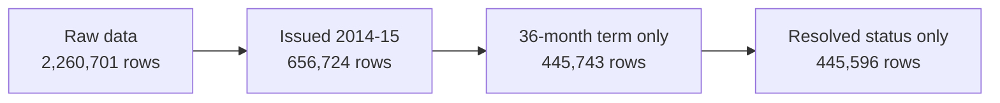
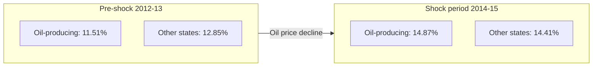
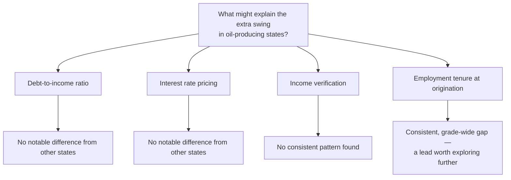

# Oil Price Shock and Regional Volatility: A 2012–2015 Analysis


**Did borrowers in oil-producing U.S. states default on loans at a different rate than borrowers elsewhere after the 2014 oil price decline — and if so, what might explain it?**

This project uses public Lending Club loan data to examine that question with a before/after (difference-in-differences) comparison, supported by SQL analysis and a Power BI dashboard.

---

## Table of Contents

1. [Overview](#overview)
2. [Repository Structure](#repository-structure)
3. [Dataset](#dataset)
4. [Methodology](#methodology)
5. [Key Findings](#key-findings)
6. [Explanatory Factors Tested](#explanatory-factors-tested)
7. [Visualizations](#visualizations)
8. [Tech Stack](#tech-stack)
9. [How to Reproduce](#how-to-reproduce)
10. [Limitations](#limitations)

---

## Overview

Seven U.S. states have economies closely tied to oil and gas: Texas, North Dakota, Oklahoma, New Mexico, Louisiana, Wyoming, Alaska (**TX, ND, OK, NM, LA, WY, AK**). When oil prices fell sharply starting in mid-2014, it's reasonable to ask whether borrowers in these states became more likely to default on personal loans than borrowers elsewhere.

This project compares loan charge-off rates between oil-producing and other states across two windows — **before** the price decline (2012–2013) and **during the decline** (2014–2015) — to see whether a measurable shift appears, and explores a few possible explanations for it.

> **A note on how to read the findings below:** results are described as *associations* and *patterns consistent with* a possible effect, not as definitively proven causation. Several supporting checks (timing alignment, consistency across credit grades, elimination of competing explanations) make the story more credible, but this remains observational data rather than a controlled experiment.

---

## Repository Structure

Oil-Price-Shock-Regional-Volatility/
│
├── README.md
├── LICENSE
├── .gitignore
│
├── data/
│   ├── raw/                      # Instructions for obtaining the source file (not committed — too large for git)
│   └── processed/                # Cleaned cohort exports (CSV)
│
├── sql/
│   ├── 01_filters_funnel.sql
│   ├── 02_cohort_summary.sql
│   ├── 03_preshock_vs_shock.sql
│   ├── 04_grade_breakdown.sql
│   ├── 05_quarterly_trend.sql
│   └── 06_explanatory_factors.sql
│
├── notebooks/
│   └── statistical_validation.py
│
├── reports/
│   ├── Week_1_Report.docx
│   ├── Week_2_Report.docx
│   └── figures/                  # Exported Power BI chart images
│
├── dashboard/
│   └── LoanData_Analysis.pbix
│
└── docs/
    └── data_dictionary.md
---

## Dataset

| Item | Detail |
|---|---|
| Source | [Kaggle — Lending Club Loan Data](https://www.kaggle.com/datasets/wordsforthewise/lending-club) (public mirror) |
| File | `accepted_2007_to_2018Q4.csv` |
| Raw size | 2,260,701 rows, 151 columns |
| Version used | Cleaned subset, filtered to the cohort described below |
| Key columns | `addr_state`, `issue_d`, `loan_status`, `term`, `grade`, `dti`, `int_rate`, `verification_status`, `emp_length` |

---

## Methodology

### Step 1 — Build a clean, comparable cohort

Only loans that had **finished** their term were usable, since a loan still in progress has no final outcome yet.



**Filtering rules:**

| Rule | Choice | Reasoning |
|---|---|---|
| Loan term | 36 months only | A 60-month loan issued in late 2015 would not mature until 2020 |
| Issue window | Jan 2014 – Dec 2015 (shock) and Jan 2012 – Dec 2013 (pre-shock) | Covers both the event window and a comparable "before" window |
| Denominator | Fully Paid + Charged Off only | Only finished loans have a known outcome |
| Data quality | 33 blank rows removed; 147 unresolved loans (0.03%) excluded | Both checked to confirm they do not meaningfully affect results |

### Step 2 — Compare the two time windows (difference-in-differences)



### Step 3 — Test possible explanations



---

## Key Findings

### 1. Charge-off rates for loans issued in 2014-15

| Group | Loans | Charged off | Charge-off rate |
|---|---|---|---|
| Oil-producing states | 50,972 | 7,581 | **14.87%** |
| Other states | 394,624 | 56,866 | **14.41%** |
| **Total (2014-15 cohort )** | **445,596** | **64,447** | **14.46%** |

Gap: **+0.46 percentage points**. On its own, this gap is modest and does not establish whether it is tied to the oil shock or simply a pre-existing regional difference.

### 2. The gap reverses direction — the project's central finding

| Period | Oil-producing | Other states | Gap |
|---|---|---|---|
| Pre-shock (2012–13) | 11.51% | 12.85% | **−1.34 pts** (oil-producing lower) |
| Shock period (2014–15) | 14.87% | 14.41% | **+0.46 pts** (oil-producing higher) |
| **Swing** | | | **+1.80 pts** |

Both groups' rates rose over time, but oil-producing states rose faster (**+3.36 pts** vs. **+1.56 pts** for other states). The gap turns positive starting around **Q3 2014**, roughly when oil prices began their decline — a timing alignment that adds some weight to a possible connection, though it does not rule out other factors moving at the same time.

### 3. Pattern across credit grades

| Grade | Pre-shock gap | Shock-period gap | Swing |
|---|-----------|-----------|---------------|
| A | −0.63 pts | +0.69 pts | **+1.32 pts** |
| B | −1.07 pts | +0.47 pts | **+1.54 pts** |
| C | −1.26 pts | +0.38 pts | **+1.64 pts** |
| D | −2.76 pts | +0.79 pts | **+3.55 pts** |
| E | −1.43 pts | +0.87 pts | **+2.30 pts** |
| F | −1.54 pts | +3.01 pts | **+4.55 pts** |
| G | +13.89 pts | +9.04 pts | −4.85 pts (unreliable — see note) |

The swing is generally larger for riskier grades, though **not strictly linear** — grade E is smaller than grade D. Grade G's swing is shown for completeness but should not be read as a real finding: its pre-shock oil-producing sample was only 3 loans, far too small to draw any conclusion from.

### 4. State-level detail of oil-producing group during shock period

The **14.87% oil-producing charge-off rate** reported above is a single blended average across all seven states — but it hides real variation underneath it. The seven states did not perform uniformly.

- Rates varied meaningfully across the seven states:
  
- **Oklahoma (OK, 17.90%)** was the highest.
- **Louisiana (LA, 16.68%)** and **New Mexico (NM, 15.75%)** also ran well above Texas, showing the group isn't uniform
- **Wyoming (WY, 12.07%)** had the lowest point estimate, but its confidence interval overlaps with Texas's, so it should not be read as    a confirmed statistical difference
- **Texas (TX, ~37,000 loans, 14.32%)** represents **72.4%** of all oil-producing loan volume, so the pooled oil-producing rate is          heavily shaped by Texas specifically
- Excluding Texas, the remaining six states show a **higher** combined rate (**16.34%**, 14,054 loans)
- The smallest samples (**North Dakota (ND): 311, Wyoming (WY): 978, Alaska (AK): 1,067**) carry the widest confidence intervals and        should not be read as reliable on their own

- Texas accounts for 72.4% of the group's loan volume, so its outcome dominates the pooled rate — and Texas performed comparatively well    during the shock period.
  Accordingly, the pooled rate was re-examined with Texas excluded as a sensitivity check. This yields a rate of 16.34% for the remaining   six states- a result that does not supersede the primary 14.87% finding.

---

## Explanatory Factors Tested

| Factor | Result |
|---|---|
| Debt-to-income ratio (DTI) | Moved similarly to other states — not a clear driver |
| Interest rate pricing | Moved similarly to other states — not a clear driver |
| Income verification status | No consistent pattern found |
| **Employment tenure at origination** | Shorter tenure in oil-producing states, with the gap widening across riskier grades (A: −0.09 yrs → F: −0.88 yrs). The most consistent lead found, though measured at loan origination rather than during the loan term, so it is not proof that specific borrowers who charged off lost their jobs mid-loan |

---

## Visualizations

The `/dashboard` folder contains the Power BI file; static exports live in `/reports/figures`:

- **Charge-off rate: pre-shock vs. shock period** — grouped bar chart
- **State-level loan volume vs. charge-off rate** — bubble chart, bubble size represents loan volume
- **Charge-off gap change by loan grade** — bar chart, grades A–F
- **Charge-off gap by loan issue quarter** — line chart, 2012–2015, with the mid-2014 oil price decline marked

---

## Tech Stack

| Tool | Role |
|---|---|
| **SQL** | Filtering, aggregation, cohort construction, difference-in-differences queries |
| **Pandas** | Data cleaning and exploratory analysis |
| **SciPy** | Statistical validation — two-proportion z-test and confidence interval on the headline gap |
| **Power BI** | Dashboarding and visualization |
| **Git / GitHub** | Version control and project hosting |

---

## How to Reproduce

```bash
# 1. Clone the repo
git clone https://github.com/Tarjani-dev/Oil-Price-Shock-Regional-Volatility.git
cd Oil-Price-Shock-Regional-Volatility

# 2. Download the source dataset (not committed due to size)
# See data/raw/README.md for the Kaggle download link

# 3. Run the SQL scripts in /sql, in numeric order, against the loaded table

# 4. Open dashboard/LoanData_Analysis.pbix in Power BI Desktop to explore the visuals
```

---

## Limitations

- Employment tenure is a lead, not a confirmed cause
- Small state-level samples (ND, WY, AK) limit how much weight their individual rates should carry
- DTI excludes mortgage payments and relies on self-reported, sometimes unverified income
- The grade-level swing pattern is not strictly linear (grade E breaks the trend; grade G excluded for sample size)
- This is observational data rather than a controlled experiment, so other unmeasured factors could also be contributing


---

## Author

**Tarjani Pagare** — [GitHub](https://github.com/Tarjani-dev)
